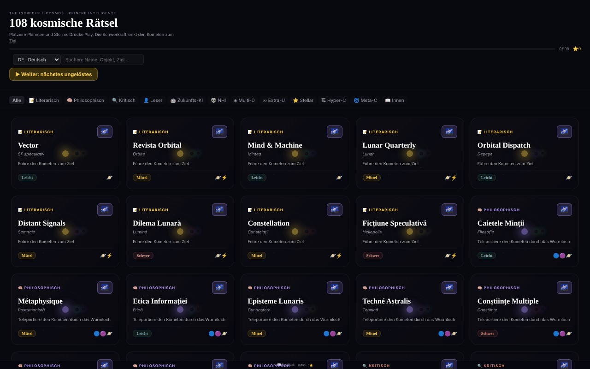

# The Incredible Cosmos

[English](README.md) · [Română](README.ro.md) · [Français](README.fr.md) · [Italiano](README.it.md) · [Español](README.es.md) · [Português](README.pt.md) · **Deutsch** · [Magyar](README.hu.md)

**Version:** 1.2.4 · **Zuletzt aktualisiert:** 2026-10-22

Oberflächensprachen: **Română, English, Français, Italiano, Español, Português (PT), Deutsch, Magyar**

108 kosmische Schwerkraft-Rätsel in einer einzigen HTML-Datei, mit einem prozeduralen 3D-Universum für jedes Rätsel.

**Online-Anwendung:** https://chiuta.github.io/IncredibleCosmos/

## Was es ist

Ein Rätselspiel auf Basis der Schwerkraft: Sie platzieren Planeten, Sterne und andere Objekte so, dass ihre Gravitation einen Kometen zum Ziel lenkt. Die Anwendung enthält 108 Rätsel in 12 thematischen Kategorien, mit drei Schwierigkeitsstufen (Leicht, Mittel, Schwer) und einer Bewertung von einem bis zu drei Sternen. Die Oberfläche ist auf Rumänisch; der angezeigte Titel lautet „The Incredible Cosmos · 108 Puzzle-uri Cosmice“.

## Funktionen

- 108 Rätsel, gruppiert in 12 Kategorien (Literarisch, Philosophisch, Kritisch, Leser, KI der Zukunft, NHI, Multi-D, Extra-U, Stellar, Hyper-C, Meta-C, Inneres), mit Kategoriefilter („Alle“) und dem Feld **Rätsel suchen**: Es durchsucht Namen, Untertitel, Ziele, Kategorien, Schwierigkeit und die verfügbaren Objekte (z. B. „wormhole“, „teleportiert“, „leicht“), ohne diakritische Zeichen zu berücksichtigen und wobei alle Wörter passen müssen; es zeigt die Anzahl der Ergebnisse an.
- Platzierbare Objekte: Planet, Stern, Schwarzes Loch, Booster, Bombe, Wirbel, Wormhole A und Wormhole B.
- Ein je nach Rätsel unterschiedliches Ziel, zum Beispiel „Lenke den Kometen zum Ziel“, „Teleportiere den Kometen durch das Wormhole“ oder „So wenige Objekte wie möglich“.
- Simulation mit den Schaltflächen **▶ PLAY**, Geschwindigkeiten 0,5×/1×/2×/4×, **↩** (rückgängig) und **↻** (zurücksetzen); die Flugbahn des Kometen erscheint als gepunktete Linie.
- Sternebewertung: Je weniger Objekte verwendet werden, desto mehr Sterne; das beste Ergebnis pro Rätsel wird gespeichert.
- Die Schaltfläche **3D-Universum** jedes Rätsels öffnet eine prozedurale 3D-Ansicht (Three.js), die sich mit der Maus oder dem Finger drehen lässt, mit Zoom über das Mausrad.
- **Tastatur:** `Tab` im Spielbildschirm, die Pfeiltasten (Umschalt = großer Schritt) bewegen einen Cursor, `Eingabe`/`Leertaste` platziert das ausgewählte Objekt, `1`–`8` wählen das Objekt, `P` = Play, `U` = rückgängig, `R` = zurücksetzen; Ergebnisse und Aktionen werden Screenreadern angesagt (`aria-live`-Region).
- Galerie: „▶ Weiter: das nächste ungelöste“ und „Fortschritt löschen“ (mit Bestätigung); die Sterne werden gespeichert, sobald Sie das Rätsel lösen.
- Ein Link „📖 Das Buch“ zu alexio.tf und Unterstützungslinks (Buy Me a Coffee).

## Anleitung

1. Wählen Sie in der Rätselliste eine Kategorie oder schreiben Sie in „Rätsel suchen“ und klicken Sie dann auf eine Karte.
2. Der Komet startet in Richtung des Pfeils. Wählen Sie ein Objekt in der Werkzeugleiste unten aus.
3. Klicken Sie auf den Bildschirm, wo Sie es platzieren möchten; ein bereits platziertes Objekt können Sie ziehen, um es zu verschieben.
4. Drücken Sie **▶ PLAY**. Die Schwerkraft lenkt den Kometen ab; erreicht er das Ziel (🎯), haben Sie gewonnen. Verfehlen Sie es, drücken Sie **↻ Erneut versuchen** oder **↻** (zurücksetzen).
5. Mit **↩** machen Sie das zuletzt platzierte Objekt rückgängig, mit den Geschwindigkeitsschaltflächen beschleunigen Sie die Simulation.
6. Schließen Sie das Rätsel am Ende und wählen Sie ein anderes; der Fortschritt (die Sterne) wird automatisch gespeichert.
7. Für die 3D-Ansicht drücken Sie auf der Karte **3D-Universum**; ziehen Sie zum Drehen, nutzen Sie das Scrollen zum Zoomen, **✕ Schließen** zum Verlassen.

## Datenschutz und Netzwerk

- **Lokaler Speicher (localStorage):** ein einziger Schlüssel, `cosmos108`, mit den bei jedem Rätsel gewonnenen Sternen. Er verlässt das Gerät nicht.
- **Netzwerk:** React 18 und Three.js r128 sind in der Datei enthalten (kein CDN). Die Anwendung sendet keine Anfragen an Server Dritter und hat keine Analyse. Die Links zu alexio.tf und Buy Me a Coffee öffnen sich nur per Klick. Die CSP-Richtlinie der Seite erlaubt Skripte nur per SHA-256-Hash (kein `'unsafe-inline'` für Skripte) und beschränkt Verbindungen auf `connect-src 'self'` (im Audit der Runde 2 nach Prüfung des Codes verschärft: keine Anfragen nach außen); externe Links sind einfache Anker.

## Lokale Ausführung / offline

Laden Sie `index.html` (ca. 0,8 MB) herunter und öffnen Sie sie in einem Browser; sie funktioniert ohne Internet. Für die 3D-Ansicht wird WebGL benötigt.

## Lizenz

MIT — siehe Datei LICENSE.

## Audit

Audit: 2026-10-10 — im Code geprüft: Die einzigen Vorkommen von `fetch`/`XMLHttpRequest` befinden sich in den ungenutzten Loadern von Three.js r128; der Code der Anwendung ruft keine externe Ressource auf. Kontrastkorrekturen und ein Stilfehler bei der Schaltfläche „Alle“.

## Verlauf / Changelog

### 1.2.4 — 2026-10-22

fff-kit 1.1.4: Touch-Ziele und Mindestschriftgröße. Touch-Ziele/Text in der App korrigiert.

### 1.2.3 — 2026-10-22

fff-kit 1.1.2: PBKDF2 mit 600.000 Iterationen, Schutz vor Clickjacking.

### 1.2.2 — 2026-10-22
- Die blockierende Browser-Bestätigung beim Zurücksetzen des Fortschritts wird durch einen übersetzten modalen Dialog (8 Sprachen) ersetzt.
- Mobil: Der gesamte Oberflächentext ist mindestens 12 px groß (zuvor 6–11 px), und die Kategoriefilter-Schaltflächen haben größere Touch-Flächen.

### 1.2.1 — 2026-10-22
- Die Untertitel der Rätsel (Sterntypen, Kategorien, Kurzbeschreibungen) sind jetzt in alle 8 Sprachen übersetzt; zuvor erschienen sie überall auf Rumänisch.

### 1.1.0 — 2026-10-14
- Sicherungskopie und Datenkennzeichnung (fff-kit).

### 1.0.0 — 2026-10-12
- Die Version und das Datum der letzten Aktualisierung werden in der Anwendung angezeigt (Fußzeile der Galerie).

### 11. Oktober 2026 (Runde 7)
- Behoben: „Rätsel suchen“ durchsuchte nur die Namen (z. B. ergab „wormhole“ 0 Ergebnisse); jetzt werden auch Untertitel, Ziel, Kategorie, Schwierigkeit und Objekte durchsucht, ohne diakritische Zeichen zu berücksichtigen, mit angesagter Ergebnisanzahl und einer Meldung, wenn es keine gibt. Der CSP-Hash des JSX-Skripts wurde neu berechnet.

### 11. Oktober 2026 (Runde 6)
- Hinzugefügt: Spielen per Tastatur (Cursor mit Pfeiltasten, Kurztasten), `aria-live`-Ansagen, „Weiter“ und „Fortschritt löschen“ in der Galerie; der Fortschritt wird beim Gewinnen gespeichert, nicht nur beim Verlassen des Rätsels.
- Sicherheit: CSP mit `script-src` per Hash (5 Skripte) statt `'unsafe-inline'`.
- Unverändert: Die 108 Rätsel bleiben Variationen derselben Mechaniken (inhaltliche Entscheidung des Autors).

### 11. Oktober 2026
- Behoben: Der 3D-Hintergrund zeigt keine körnigen Quadrate mehr; die Partikel (Sterne, Nebel) verwenden jetzt ein lokal erzeugtes weiches kreisförmiges Sprite.
- Behoben: Das Panel „Wie wird gespielt“ erscheint nur beim ersten Öffnen automatisch (localStorage-Schlüssel `cosmos108:tut`), schließt sich nach 8 Sekunden oder mit Escape von selbst und bleibt über die Schaltfläche „?“ verfügbar.
- Behoben: Struktur mit Landmarken (`<main>`, `<aside>` für die Unterstützung); 0 axe-core-Verstöße bei 1280 und 360 px.

## Autor

Alexio — Alexandru-Ionuț Chiuță. Kontakt: alexio@trom.tf

## Zusammenfassung

The Incredible Cosmos ist ein Schwerkraft-Rätselspiel in einer einzigen Datei mit 108 Rätseln in 12 thematischen Kategorien: Platzieren Sie Planeten, Sterne, Schwarze Löcher, Booster, Wirbel und Wormholes so, dass die Schwerkraft einen Kometen zu seinem Ziel lenkt, und verdienen Sie bis zu drei Sterne. Jedes Rätsel bietet zudem eine prozedurale 3D-Ansicht des Universums. React und Three.js sind eingebunden; der Fortschritt wird in localStorage gehalten (Schlüssel cosmos108), und es werden keine Hosts Dritter kontaktiert. Oberfläche auf Rumänisch. MIT-Lizenz.
