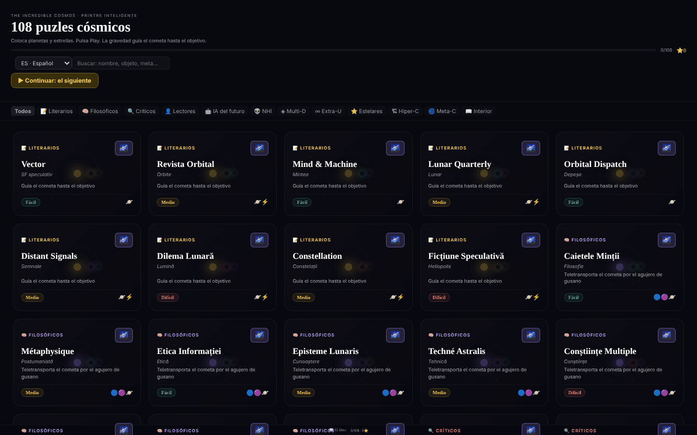

# The Incredible Cosmos

[English](README.md) · [Română](README.ro.md) · [Français](README.fr.md) · [Italiano](README.it.md) · **Español** · [Português](README.pt.md) · [Deutsch](README.de.md) · [Magyar](README.hu.md)

**Versión:** 1.2.5 · **Última actualización:** 2026-10-23

Idiomas de la interfaz: **Română, English, Français, Italiano, Español, Português (PT), Deutsch, Magyar**

108 rompecabezas cósmicos de gravedad en un único archivo HTML, con un universo 3D procedural para cada rompecabezas.

**Aplicación en línea:** https://chiuta.github.io/IncredibleCosmos/

## Qué es

Un juego de rompecabezas basado en la gravedad: colocas planetas, estrellas y otros objetos para que su gravedad guíe a un cometa hasta el objetivo. La aplicación contiene 108 rompecabezas en 12 categorías temáticas, con tres niveles de dificultad (Fácil, Medio, Difícil) y una valoración de una a tres estrellas. La interfaz está en rumano; el título que se muestra es «The Incredible Cosmos · 108 Puzzle-uri Cosmice».

## Funciones

- 108 rompecabezas, agrupados en 12 categorías (Literarias, Filosóficas, Críticas, Lectores, IA del futuro, NHI, Multi-D, Extra-U, Estelares, Hiper-C, Meta-C, Interior), con filtrado por categoría («Todas») y un campo **Buscar rompecabezas**: busca en nombres, subtítulos, objetivos, categorías, dificultad y objetos disponibles (p. ej. «wormhole», «teletransporta», «fácil»), sin tener en cuenta los signos diacríticos y exigiendo que coincidan todas las palabras; muestra el número de resultados.
- Objetos que se pueden colocar: Planeta, Estrella, Agujero negro, Booster, Bomba, Vórtice, Wormhole A y Wormhole B.
- Un objetivo que varía según el rompecabezas, por ejemplo «Guía el cometa hasta el objetivo», «Teletransporta el cometa a través del wormhole» o «El menor número posible de objetos».
- Simulación con los botones **▶ PLAY**, velocidades 0,5×/1×/2×/4×, **↩** (deshacer) y **↻** (reiniciar); la trayectoria del cometa aparece como una línea de puntos.
- Estrellas de valoración: menos objetos usados significa más estrellas; se guarda el mejor resultado por rompecabezas.
- El botón **Universo 3D** de cada rompecabezas abre una vista 3D procedural (Three.js), que se gira con el ratón o con el dedo, con zoom mediante la rueda del ratón.
- **Teclado:** `Tab` en la pantalla de juego, las flechas (Mayús = paso grande) mueven un cursor, `Intro`/`Espacio` coloca el objeto seleccionado, `1`–`8` eligen el objeto, `P` = Play, `U` = deshacer, `R` = reiniciar; los resultados y las acciones se anuncian a los lectores de pantalla (región `aria-live`).
- Galería: «▶ Continuar: el siguiente sin resolver» y «Borrar el progreso» (con confirmación); las estrellas se guardan en cuanto resuelves el rompecabezas.
- Un enlace «📖 El libro» a alexio.tf y enlaces de apoyo (Buy Me a Coffee).

## Manual de uso

1. En la lista de rompecabezas, elige una categoría o escribe en «Buscar rompecabezas» y luego pulsa una tarjeta.
2. El cometa sale en la dirección de la flecha. Selecciona un objeto de la barra de herramientas inferior.
3. Pulsa en la pantalla donde quieras colocarlo; puedes arrastrar un objeto ya colocado para moverlo.
4. Pulsa **▶ PLAY**. La gravedad desvía el cometa; si llega al objetivo (🎯), has ganado. Si lo pierdes, pulsa **↻ Reintentar** o **↻** (reiniciar).
5. Usa **↩** para deshacer el último objeto colocado y los botones de velocidad para acelerar la simulación.
6. Al final del rompecabezas, ciérralo y elige otro; el progreso (las estrellas) se guarda automáticamente.
7. Para la vista 3D, pulsa **Universo 3D** en la tarjeta; arrastra para girar, usa el desplazamiento para hacer zoom, **✕ Cerrar** para salir.

## Privacidad y red

- **Almacenamiento local (localStorage):** una sola clave, `cosmos108`, con las estrellas ganadas en cada rompecabezas. No sale del dispositivo.
- **Red:** React 18 y Three.js r128 están incluidos en el archivo (sin CDN). La aplicación no realiza solicitudes a servidores de terceros y no tiene analítica. Los enlaces a alexio.tf y Buy Me a Coffee se abren solo al hacer clic. La política CSP de la página permite los scripts solo mediante hash SHA-256 (sin `'unsafe-inline'` para scripts) y restringe las conexiones a `connect-src 'self'` (ajustada en la auditoría de la ronda 2, tras comprobar el código: ninguna solicitud al exterior); los enlaces externos son simples anclas.

## Ejecución local / sin conexión

Descarga `index.html` (aprox. 0,8 MB) y ábrelo en un navegador; funciona sin internet. Para la vista 3D se necesita WebGL.

## Licencia

MIT — consulta el archivo LICENSE.

## Auditoría

Auditoría: 2026-10-10 — verificado en el código: las únicas apariciones de `fetch`/`XMLHttpRequest` están en los cargadores (loaders) sin usar de Three.js r128; el código de la aplicación no llama a ningún recurso externo. Correcciones de contraste y un error de estilo en el botón «Todas».

## Historial / Registro de cambios

### 1.2.4 — 2026-10-22

fff-kit 1.1.4: áreas táctiles y texto mínimo. Áreas táctiles/texto corregidos en la aplicación.

### 1.2.3 — 2026-10-22

fff-kit 1.1.2: PBKDF2 con 600.000 iteraciones, protección anti-clickjacking.

### 1.2.2 — 2026-10-22
- La confirmación bloqueante del navegador al reiniciar el progreso se sustituye por un diálogo modal traducido (8 idiomas).
- Móvil: todo el texto de la interfaz mide al menos 12 px (antes 6–11 px) y los botones de filtro por categoría tienen áreas táctiles mayores.

### 1.2.1 — 2026-10-22
- Los subtítulos de los puzles (tipos de estrellas, categorías, descripciones breves) se han traducido a los 8 idiomas; antes aparecían siempre en rumano.

### 1.1.0 — 2026-10-14
- Copia de seguridad y etiquetado de datos (fff-kit).

### 1.0.0 — 2026-10-12
- La versión y la fecha de la última actualización se muestran en la aplicación (pie de la galería).

### 11 de octubre de 2026 (ronda 7)
- Corregido: «Buscar rompecabezas» solo buscaba en los nombres (p. ej. «wormhole» daba 0 resultados); ahora busca también en el subtítulo, el objetivo, la categoría, la dificultad y los objetos, sin tener en cuenta los signos diacríticos, con el número de resultados anunciado y un mensaje cuando no hay ninguno. Se ha recalculado el hash CSP del script JSX.

### 11 de octubre de 2026 (ronda 6)
- Añadido: juego con teclado (cursor con flechas, teclas rápidas), anuncios `aria-live`, «Continuar» y «Borrar el progreso» en la galería; el progreso se guarda al ganar, no solo al salir del rompecabezas.
- Seguridad: CSP con `script-src` por hash (5 scripts) en lugar de `'unsafe-inline'`.
- Sin cambios: los 108 rompecabezas siguen siendo variaciones sobre las mismas mecánicas (decisión de contenido del autor).

### 11 de octubre de 2026
- Corregido: el fondo 3D ya no muestra cuadrados granulados; las partículas (estrellas, nebulosas) usan ahora un sprite circular suave generado localmente.
- Corregido: el panel «Cómo se juega» aparece automáticamente solo en la primera apertura (clave localStorage `cosmos108:tut`), se cierra solo tras 8 segundos o con Escape y sigue disponible desde el botón «?».
- Corregido: estructura con regiones de referencia (`<main>`, `<aside>` para el apoyo); 0 infracciones de axe-core a 1280 y 360 px.

## Autor

Alexio — Alexandru-Ionuț Chiuță. Contacto: alexio@trom.tf

## Resumen

The Incredible Cosmos es un juego de rompecabezas de gravedad en un único archivo, con 108 rompecabezas en 12 categorías temáticas: coloca planetas, estrellas, agujeros negros, boosters, vórtices y wormholes para que la gravedad dirija un cometa hasta su objetivo, ganando hasta tres estrellas. Cada rompecabezas ofrece además una vista procedural del universo en 3D. React y Three.js están incluidos; el progreso se guarda en localStorage (clave cosmos108) y no se contacta con ningún host de terceros. Interfaz en rumano. Licencia MIT.
