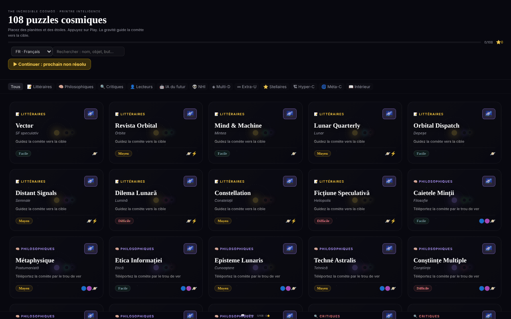

# The Incredible Cosmos

[English](README.md) · [Română](README.ro.md) · **Français** · [Italiano](README.it.md) · [Español](README.es.md) · [Português](README.pt.md) · [Deutsch](README.de.md) · [Magyar](README.hu.md)

**Version :** 1.2.5 · **Dernière mise à jour :** 2026-10-23

Langues de l'interface : **Română, English, Français, Italiano, Español, Português (PT), Deutsch, Magyar**

108 énigmes cosmiques de gravitation dans un seul fichier HTML, avec un univers 3D procédural pour chaque énigme.

**Application en ligne :** https://chiuta.github.io/IncredibleCosmos/

## Ce que c'est

Un jeu d'énigmes fondé sur la gravitation : vous placez des planètes, des étoiles et d'autres objets afin que leur gravité guide une comète vers la cible. L'application contient 108 énigmes réparties en 12 catégories thématiques, avec trois niveaux de difficulté (Facile, Moyen, Difficile) et une évaluation de une à trois étoiles. L'interface est en roumain ; le titre affiché est « The Incredible Cosmos · 108 Puzzle-uri Cosmice ».

## Fonctions

- 108 énigmes, regroupées en 12 catégories (Littéraires, Philosophiques, Critiques, Lecteurs, IA du futur, NHI, Multi-D, Extra-U, Stellaires, Hyper-C, Méta-C, Intérieur), avec filtrage par catégorie (« Toutes ») et un champ **Rechercher une énigme** : il cherche dans les noms, sous-titres, objectifs, catégories, niveaux de difficulté et objets disponibles (p. ex. « wormhole », « téléporte », « facile »), sans tenir compte des signes diacritiques et en exigeant que tous les mots correspondent ; il affiche le nombre de résultats.
- Objets à placer : Planète, Étoile, Trou noir, Booster, Bombe, Vortex, Wormhole A et Wormhole B.
- Un objectif variable selon l'énigme, par exemple « Guider la comète vers la cible », « Téléporter la comète par le wormhole » ou « Le moins d'objets possible ».
- Simulation avec les boutons **▶ PLAY**, vitesses 0,5×/1×/2×/4×, **↩** (annuler) et **↻** (réinitialiser) ; la trajectoire de la comète apparaît sous forme de ligne pointillée.
- Étoiles d'évaluation : moins d'objets utilisés donne plus d'étoiles ; le meilleur résultat par énigme est enregistré.
- Le bouton **Univers 3D** de chaque énigme ouvre une vue 3D procédurale (Three.js), que l'on fait pivoter à la souris ou au doigt, avec zoom à la molette.
- **Clavier :** `Tab` sur l'écran de jeu, les flèches (Maj = grand pas) déplacent un curseur, `Entrée`/`Espace` place l'objet sélectionné, `1`–`8` choisissent l'objet, `P` = Play, `U` = annuler, `R` = réinitialiser ; les résultats et les actions sont annoncés aux lecteurs d'écran (région `aria-live`).
- Galerie : « ▶ Continuer : la prochaine non résolue » et « Effacer la progression » (avec confirmation) ; les étoiles sont enregistrées dès que vous résolvez l'énigme.
- Un lien « 📖 Le livre » vers alexio.tf et des liens de soutien (Buy Me a Coffee).

## Mode d'emploi

1. Dans la liste des énigmes, choisissez une catégorie ou saisissez un terme dans « Rechercher une énigme », puis cliquez sur une carte.
2. La comète part dans la direction de la flèche. Sélectionnez un objet dans la barre d'outils du bas.
3. Cliquez sur l'écran à l'endroit où vous voulez le placer ; vous pouvez faire glisser un objet déjà placé pour le déplacer.
4. Appuyez sur **▶ PLAY**. La gravité dévie la comète ; si elle atteint la cible (🎯), vous avez gagné. Si vous la manquez, appuyez sur **↻ Réessayer** ou sur **↻** (réinitialiser).
5. Utilisez **↩** pour annuler le dernier objet placé et les boutons de vitesse pour accélérer la simulation.
6. À la fin de l'énigme, fermez-la et choisissez-en une autre ; la progression (les étoiles) est enregistrée automatiquement.
7. Pour la vue 3D, appuyez sur **Univers 3D** sur la carte ; faites glisser pour pivoter, utilisez la molette pour zoomer, **✕ Fermer** pour quitter.

## Confidentialité et réseau

- **Stockage local (localStorage) :** une seule clé, `cosmos108`, contenant les étoiles obtenues à chaque énigme. Elle ne quitte pas l'appareil.
- **Réseau :** React 18 et Three.js r128 sont inclus dans le fichier (pas de CDN). L'application n'envoie aucune requête à des serveurs tiers et n'a pas d'outil d'analyse. Les liens vers alexio.tf et Buy Me a Coffee ne s'ouvrent qu'au clic. La politique CSP de la page n'autorise les scripts que par empreinte SHA-256 (sans `'unsafe-inline'` pour les scripts) et restreint les connexions à `connect-src 'self'` (resserrée lors de l'audit du tour 2, après vérification du code : aucune requête vers l'extérieur) ; les liens externes sont de simples ancres.

## Exécution locale / hors ligne

Téléchargez `index.html` (environ 0,8 Mo) et ouvrez-le dans un navigateur ; il fonctionne sans internet. La vue 3D nécessite WebGL.

## Licence

MIT — voir le fichier LICENSE.

## Audit

Audit : 2026-10-10 — vérifié dans le code : les seules occurrences de `fetch`/`XMLHttpRequest` se trouvent dans les chargeurs (loaders) inutilisés de Three.js r128 ; le code de l'application n'appelle aucune ressource externe. Corrections de contraste et un bogue de style sur le bouton « Toutes ».

## Historique / Journal des modifications

### 1.2.4 — 2026-10-22

fff-kit 1.1.4 : cibles tactiles et taille de texte minimale. Cibles tactiles/texte corrigés dans l’application.

### 1.2.3 — 2026-10-22

fff-kit 1.1.2 : PBKDF2 600 000 itérations, protection anti-clickjacking.

### 1.2.2 — 2026-10-22
- La confirmation bloquante du navigateur lors de la réinitialisation de la progression est remplacée par un dialogue modal traduit (8 langues).
- Mobile : tout le texte de l'interface fait au moins 12 px (il était de 6 à 11 px) et les boutons de filtre par catégorie ont des cibles tactiles plus grandes.

### 1.2.1 — 2026-10-22
- Les sous-titres des énigmes (types d'étoiles, catégories, courtes descriptions) sont traduits dans les 8 langues ; ils s'affichaient auparavant en roumain partout.

### 1.1.0 — 2026-10-14
- Copie de sauvegarde et étiquetage des données (fff-kit).

### 1.0.0 — 2026-10-12
- La version et la date de la dernière mise à jour sont affichées dans l'application (pied de la galerie).

### 11 octobre 2026 (tour 7)
- Corrigé : « Rechercher une énigme » ne cherchait que dans les noms (p. ex. « wormhole » donnait 0 résultat) ; il cherche désormais aussi dans le sous-titre, l'objectif, la catégorie, la difficulté et les objets, sans tenir compte des signes diacritiques, avec le nombre de résultats annoncé et un message lorsqu'il n'y en a aucun. L'empreinte CSP du script JSX a été recalculée.

### 11 octobre 2026 (tour 6)
- Ajouté : jeu au clavier (curseur avec les flèches, raccourcis), annonces `aria-live`, « Continuer » et « Effacer la progression » dans la galerie ; la progression est enregistrée à la victoire, et pas seulement en quittant l'énigme.
- Sécurité : CSP avec `script-src` par empreinte (5 scripts) au lieu de `'unsafe-inline'`.
- Inchangé : les 108 énigmes restent des variations sur les mêmes mécaniques (décision de contenu de l'auteur).

### 11 octobre 2026
- Corrigé : l'arrière-plan 3D n'affiche plus de carrés granuleux ; les particules (étoiles, nébuleuses) utilisent désormais un sprite circulaire doux généré localement.
- Corrigé : le panneau « Comment jouer » n'apparaît automatiquement qu'à la première ouverture (clé localStorage `cosmos108:tut`), se ferme tout seul après 8 secondes ou avec Échap, et reste disponible depuis le bouton « ? ».
- Corrigé : structure avec repères (`<main>`, `<aside>` pour le soutien) ; 0 violation axe-core à 1280 et 360 px.

## Auteur

Alexio — Alexandru-Ionuț Chiuță. Contact : alexio@trom.tf

## Résumé

The Incredible Cosmos est un jeu d'énigmes de gravitation en un seul fichier, avec 108 énigmes réparties en 12 catégories thématiques : placez des planètes, des étoiles, des trous noirs, des boosters, des vortex et des wormholes pour que la gravité guide une comète vers sa cible, et obtenez jusqu'à trois étoiles. Chaque énigme propose aussi une vue d'univers 3D procédurale. React et Three.js sont intégrés ; la progression est conservée dans localStorage (clé cosmos108) et aucun hôte tiers n'est contacté. Interface en roumain. Licence MIT.
