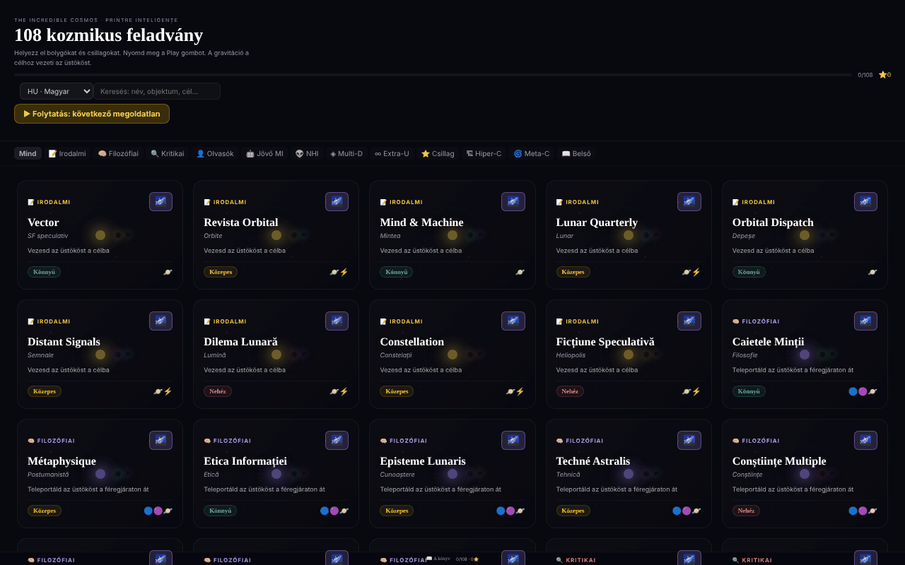

# The Incredible Cosmos

[English](README.md) · [Română](README.ro.md) · [Français](README.fr.md) · [Italiano](README.it.md) · [Español](README.es.md) · [Português](README.pt.md) · [Deutsch](README.de.md) · **Magyar**

**Verzió:** 1.2.0 · **Utolsó frissítés:** 2026-10-19

A felület nyelvei: **Română, English, Français, Italiano, Español, Português (PT), Deutsch, Magyar**

108 kozmikus gravitációs fejtörő egyetlen HTML-fájlban, minden fejtörőhöz procedurális 3D univerzummal.

**Online alkalmazás:** https://chiuta.github.io/IncredibleCosmos/

## Mi ez

Gravitáción alapuló fejtörőjáték: bolygókat, csillagokat és más objektumokat helyezel el úgy, hogy a gravitációjuk egy üstököst vezessen a célhoz. Az alkalmazás 108 fejtörőt tartalmaz 12 tematikus kategóriában, három nehézségi szinttel (Könnyű, Közepes, Nehéz) és egytől háromig terjedő csillagos értékeléssel. A felület román nyelvű; a megjelenített cím „The Incredible Cosmos · 108 Puzzle-uri Cosmice”.

## Funkciók

- 108 fejtörő, 12 kategóriába csoportosítva (Irodalmi, Filozófiai, Kritikai, Olvasók, Jövő MI-je, NHI, Multi-D, Extra-U, Csillagászati, Hiper-C, Meta-C, Belső), kategóriaszűréssel („Mind”) és egy **Fejtörő keresése** mezővel: a nevek, alcímek, célok, kategóriák, nehézség és az elérhető objektumok között keres (pl. „wormhole”, „teleportál”, „könnyű”), a diakritikus jelek figyelmen kívül hagyásával, és minden szónak egyeznie kell; megjeleníti a találatok számát.
- Elhelyezhető objektumok: Bolygó, Csillag, Fekete lyuk, Booster, Bomba, Örvény, Wormhole A és Wormhole B.
- Fejtörőnként változó cél, például „Vezesd az üstököst a célhoz”, „Teleportáld az üstököst a wormholeon át” vagy „Minél kevesebb objektum”.
- Szimuláció **▶ PLAY** gombokkal, 0,5×/1×/2×/4× sebességgel, **↩** (visszavonás) és **↻** (visszaállítás); az üstökös pályája pontozott vonalként jelenik meg.
- Csillagos értékelés: minél kevesebb objektumot használsz, annál több csillagot kapsz; fejtörőnként a legjobb eredmény kerül mentésre.
- Minden fejtörő **3D univerzum** gombja procedurális 3D nézetet nyit meg (Three.js), amelyet egérrel vagy ujjal lehet forgatni, az egérgörgővel pedig nagyítani.
- **Billentyűzet:** `Tab` a játékképernyőn, a nyilak (Shift = nagy lépés) mozgatnak egy kurzort, az `Enter`/`Szóköz` elhelyezi a kijelölt objektumot, az `1`–`8` kiválasztja az objektumot, `P` = Play, `U` = visszavonás, `R` = visszaállítás; az eredményeket és a műveleteket felolvassák a képernyőolvasók számára (`aria-live` régió).
- Galéria: „▶ Folytatás: a következő megoldatlan” és „Haladás törlése” (megerősítéssel); a csillagok azonnal mentésre kerülnek, amint megoldod a fejtörőt.
- „📖 A könyv” hivatkozás az alexio.tf oldalra és támogatási hivatkozások (Buy Me a Coffee).

## Használati útmutató

1. A fejtörők listájából válassz kategóriát, vagy írj a „Fejtörő keresése” mezőbe, majd kattints egy kártyára.
2. Az üstökös a nyíl irányába indul. Válassz ki egy objektumot az alsó eszköztárból.
3. Kattints a képernyőn arra a helyre, ahová el szeretnéd helyezni; egy már elhelyezett objektumot áthúzással mozgathatsz.
4. Nyomd meg a **▶ PLAY** gombot. A gravitáció eltéríti az üstököst; ha eléri a célt (🎯), nyertél. Ha elvéted, nyomd meg a **↻ Újra** vagy a **↻** (visszaállítás) gombot.
5. A **↩** gombbal visszavonhatod az utoljára elhelyezett objektumot, a sebességgombokkal pedig gyorsíthatod a szimulációt.
6. A fejtörő végén zárd be, és válassz egy másikat; a haladás (a csillagok) automatikusan mentésre kerül.
7. A 3D nézethez nyomd meg a kártyán a **3D univerzum** gombot; húzással forgathatod, görgetéssel nagyíthatod, a **✕ Bezárás** gombbal kiléphetsz.

## Adatvédelem és hálózat

- **Helyi tárolás (localStorage):** egyetlen kulcs, a `cosmos108`, az egyes fejtörőknél szerzett csillagokkal. Nem hagyja el az eszközt.
- **Hálózat:** a React 18 és a Three.js r128 a fájlba van építve (CDN nélkül). Az alkalmazás nem küld kéréseket harmadik fél szervereinek, és nincs analitikája. Az alexio.tf és a Buy Me a Coffee hivatkozásai csak kattintásra nyílnak meg. Az oldal CSP-szabályzata a szkripteket csak SHA-256 ellenőrzőösszeg alapján engedélyezi (szkriptekhez nincs `'unsafe-inline'`), és a kapcsolatokat a `connect-src 'self'` irányelvre korlátozza (a 2. forduló auditján szigorítva, a kód ellenőrzése után: nincs kérés kifelé); a külső hivatkozások egyszerű horgonyok.

## Helyi futtatás / offline

Töltsd le az `index.html` fájlt (kb. 0,8 MB), és nyisd meg böngészőben; internet nélkül is működik. A 3D nézethez WebGL szükséges.

## Licenc

MIT — lásd a LICENSE fájlt.

## Audit

Audit: 2026-10-10 — a kódban ellenőrizve: a `fetch`/`XMLHttpRequest` egyetlen előfordulása a Three.js r128 nem használt betöltőiben (loader) található; az alkalmazás kódja nem hív meg semmilyen külső erőforrást. Kontrasztjavítások és egy stílushiba a „Mind” gombnál.

## Előzmények / Változásnapló

### 1.1.0 — 2026-10-14
- Biztonsági másolat és adatcímkézés (fff-kit).

### 1.0.0 — 2026-10-12
- A verzió és az utolsó frissítés dátuma megjelenik az alkalmazásban (a galéria láblécében).

### 2026. október 11. (7. forduló)
- Javítva: a „Fejtörő keresése” csak a nevekben keresett (pl. a „wormhole” 0 találatot adott); mostantól az alcímben, a célban, a kategóriában, a nehézségben és az objektumokban is keres, a diakritikus jelek figyelmen kívül hagyásával, a találatok számának felolvasásával és üzenettel, ha nincs találat. A JSX-szkript CSP-ellenőrzőösszege újraszámolva.

### 2026. október 11. (6. forduló)
- Hozzáadva: billentyűzetes játék (kurzor nyilakkal, gyorsbillentyűk), `aria-live` közlemények, „Folytatás” és „Haladás törlése” a galériában; a haladás nyeréskor mentésre kerül, nem csak a fejtörő elhagyásakor.
- Biztonság: CSP ellenőrzőösszeg alapú `script-src`-vel (5 szkript) az `'unsafe-inline'` helyett.
- Változatlan: a 108 fejtörő ugyanazon mechanikák variációja marad (a szerző tartalmi döntése).

### 2026. október 11.
- Javítva: a 3D háttér már nem mutat szemcsés négyzeteket; a részecskék (csillagok, ködök) mostantól helyben generált lágy, kör alakú sprite-ot használnak.
- Javítva: a „Hogyan kell játszani” panel csak az első megnyitáskor jelenik meg automatikusan (localStorage-kulcs: `cosmos108:tut`), 8 másodperc után vagy az Escape-pel magától bezáródik, és a „?” gombról továbbra is elérhető.
- Javítva: szerkezet tájékozódási pontokkal (`<main>`, `<aside>` a támogatáshoz); 0 axe-core szabálysértés 1280 és 360 px szélességnél.

## Szerző

Alexio — Alexandru-Ionuț Chiuță. Kapcsolat: alexio@trom.tf

## Összefoglaló

A The Incredible Cosmos egyfájlos gravitációs fejtörőjáték 108 fejtörővel 12 tematikus kategóriában: helyezz el bolygókat, csillagokat, fekete lyukakat, boostereket, örvényeket és wormholeokat úgy, hogy a gravitáció egy üstököst a céljához vezessen, akár három csillagot is szerezve. Minden fejtörő procedurális 3D univerzumnézetet is kínál. A React és a Three.js be van építve; a haladás a localStorage-ban marad (cosmos108 kulcs), és nem veszi fel a kapcsolatot harmadik fél hosztjával. Román nyelvű felület. MIT licenc.
