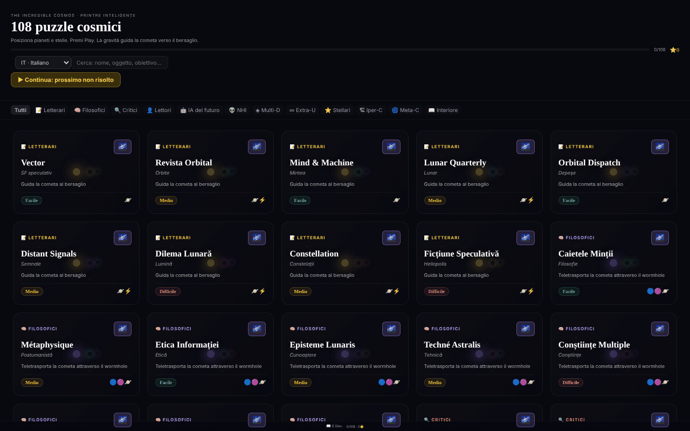

# The Incredible Cosmos

[English](README.md) · [Română](README.ro.md) · [Français](README.fr.md) · **Italiano** · [Español](README.es.md) · [Português](README.pt.md) · [Deutsch](README.de.md) · [Magyar](README.hu.md)

**Versione:** 1.2.3 · **Ultimo aggiornamento:** 2026-10-22

Lingue dell'interfaccia: **Română, English, Français, Italiano, Español, Português (PT), Deutsch, Magyar**

108 rompicapi cosmici di gravità in un unico file HTML, con un universo 3D procedurale per ogni rompicapo.

**Applicazione online:** https://chiuta.github.io/IncredibleCosmos/

## Che cos'è

Un gioco di rompicapi basato sulla gravità: posizioni pianeti, stelle e altri oggetti in modo che la loro gravità guidi una cometa verso il bersaglio. L'applicazione contiene 108 rompicapi in 12 categorie tematiche, con tre livelli di difficoltà (Facile, Medio, Difficile) e una valutazione da una a tre stelle. L'interfaccia è in rumeno; il titolo visualizzato è «The Incredible Cosmos · 108 Puzzle-uri Cosmice».

## Funzioni

- 108 rompicapi, raggruppati in 12 categorie (Letterarie, Filosofiche, Critiche, Lettori, IA del futuro, NHI, Multi-D, Extra-U, Stellari, Hiper-C, Meta-C, Interno), con filtro per categoria («Tutte») e un campo **Cerca rompicapo**: cerca in nomi, sottotitoli, obiettivi, categorie, difficoltà e oggetti disponibili (ad es. «wormhole», «teletrasporta», «facile»), senza tener conto dei segni diacritici e richiedendo che tutte le parole corrispondano; mostra il numero di risultati.
- Oggetti da posizionare: Pianeta, Stella, Buco nero, Booster, Bomba, Vortice, Wormhole A e Wormhole B.
- Un obiettivo variabile a seconda del rompicapo, ad esempio «Guida la cometa al bersaglio», «Teletrasporta la cometa attraverso il wormhole» o «Il minor numero possibile di oggetti».
- Simulazione con i pulsanti **▶ PLAY**, velocità 0,5×/1×/2×/4×, **↩** (annulla) e **↻** (reimposta); la traiettoria della cometa appare come una linea punteggiata.
- Stelle di valutazione: meno oggetti usati significa più stelle; il miglior risultato per rompicapo viene salvato.
- Il pulsante **Universo 3D** di ogni rompicapo apre una vista 3D procedurale (Three.js), ruotata con il mouse o con il dito, con zoom tramite la rotellina del mouse.
- **Tastiera:** `Tab` nella schermata di gioco, le frecce (Maiusc = passo grande) spostano un cursore, `Invio`/`Spazio` posiziona l'oggetto selezionato, `1`–`8` scelgono l'oggetto, `P` = Play, `U` = annulla, `R` = reimposta; risultati e azioni sono annunciati ai lettori di schermo (regione `aria-live`).
- Galleria: «▶ Continua: il prossimo non risolto» e «Cancella i progressi» (con conferma); le stelle vengono salvate non appena risolvi il rompicapo.
- Un link «📖 Il libro» verso alexio.tf e link di sostegno (Buy Me a Coffee).

## Guida all'uso

1. Dall'elenco dei rompicapi, scegli una categoria o scrivi in «Cerca rompicapo», poi fai clic su una scheda.
2. La cometa parte nella direzione della freccia. Seleziona un oggetto dalla barra degli strumenti in basso.
3. Fai clic sullo schermo dove vuoi posizionarlo; puoi trascinare un oggetto già posizionato per spostarlo.
4. Premi **▶ PLAY**. La gravità devia la cometa; se raggiunge il bersaglio (🎯), hai vinto. Se lo manchi, premi **↻ Riprova** o **↻** (reimposta).
5. Usa **↩** per annullare l'ultimo oggetto posizionato e i pulsanti di velocità per accelerare la simulazione.
6. Alla fine del rompicapo, chiudilo e scegline un altro; i progressi (le stelle) vengono salvati automaticamente.
7. Per la vista 3D, premi **Universo 3D** sulla scheda; trascina per ruotare, usa la rotellina per lo zoom, **✕ Chiudi** per uscire.

## Riservatezza e rete

- **Archiviazione locale (localStorage):** una sola chiave, `cosmos108`, con le stelle ottenute in ogni rompicapo. Non lascia il dispositivo.
- **Rete:** React 18 e Three.js r128 sono inclusi nel file (nessuna CDN). L'applicazione non invia richieste a server di terzi e non ha analisi statistica. I link verso alexio.tf e Buy Me a Coffee si aprono solo al clic. La politica CSP della pagina consente gli script solo tramite hash SHA-256 (senza `'unsafe-inline'` per gli script) e limita le connessioni a `connect-src 'self'` (rafforzata nell'audit del round 2, dopo la verifica del codice: nessuna richiesta verso l'esterno); i link esterni sono semplici ancore.

## Esecuzione locale / offline

Scarica `index.html` (circa 0,8 MB) e aprilo in un browser; funziona senza internet. Per la vista 3D serve WebGL.

## Licenza

MIT — vedi il file LICENSE.

## Audit

Audit: 2026-10-10 — verificato nel codice: le uniche occorrenze di `fetch`/`XMLHttpRequest` si trovano nei caricatori (loader) inutilizzati di Three.js r128; il codice dell'applicazione non richiama alcuna risorsa esterna. Correzioni di contrasto e un bug di stile nel pulsante «Tutte».

## Cronologia / Changelog

### 1.2.3 — 2026-10-22

fff-kit 1.1.2: PBKDF2 a 600.000 iterazioni, protezione anti-clickjacking.

### 1.2.2 — 2026-10-22
- La conferma bloccante del browser al ripristino dei progressi è sostituita da una finestra modale tradotta (8 lingue).
- Mobile: tutto il testo dell'interfaccia è di almeno 12 px (prima era 6–11 px) e i pulsanti di filtro per categoria hanno aree tattili più grandi.

### 1.2.1 — 2026-10-22
- I sottotitoli dei puzzle (tipi di stelle, categorie, brevi descrizioni) sono tradotti in tutte e 8 le lingue; prima comparivano ovunque in rumeno.

### 1.1.0 — 2026-10-14
- Copia di riserva ed etichettatura dei dati (fff-kit).

### 1.0.0 — 2026-10-12
- La versione e la data dell'ultimo aggiornamento sono mostrate nell'applicazione (piè di pagina della galleria).

### 11 ottobre 2026 (round 7)
- Corretto: «Cerca rompicapo» cercava solo nei nomi (ad es. «wormhole» dava 0 risultati); ora cerca anche in sottotitolo, obiettivo, categoria, difficoltà e oggetti, senza tener conto dei segni diacritici, con il numero di risultati annunciato e un messaggio quando non ce ne sono. L'hash CSP dello script JSX è stato ricalcolato.

### 11 ottobre 2026 (round 6)
- Aggiunto: gioco da tastiera (cursore con le frecce, tasti rapidi), annunci `aria-live`, «Continua» e «Cancella i progressi» nella galleria; i progressi vengono salvati alla vittoria, non solo quando si lascia il rompicapo.
- Sicurezza: CSP con `script-src` tramite hash (5 script) al posto di `'unsafe-inline'`.
- Invariato: i 108 rompicapi restano variazioni sulle stesse meccaniche (decisione di contenuto dell'autore).

### 11 ottobre 2026
- Corretto: lo sfondo 3D non mostra più quadrati granulosi; le particelle (stelle, nebulose) usano ora uno sprite circolare morbido generato localmente.
- Corretto: il pannello «Come si gioca» compare automaticamente solo alla prima apertura (chiave localStorage `cosmos108:tut`), si chiude da solo dopo 8 secondi o con Esc e resta disponibile dal pulsante «?».
- Corretto: struttura con punti di riferimento (`<main>`, `<aside>` per il sostegno); 0 violazioni axe-core a 1280 e 360 px.

## Autore

Alexio — Alexandru-Ionuț Chiuță. Contatto: alexio@trom.tf

## Riepilogo

The Incredible Cosmos è un gioco di rompicapi di gravità in un unico file, con 108 rompicapi in 12 categorie tematiche: posiziona pianeti, stelle, buchi neri, booster, vortici e wormhole in modo che la gravità guidi una cometa verso il bersaglio, guadagnando fino a tre stelle. Ogni rompicapo offre anche una vista procedurale dell'universo in 3D. React e Three.js sono inclusi; i progressi sono conservati in localStorage (chiave cosmos108) e non viene contattato alcun host di terzi. Interfaccia in rumeno. Licenza MIT.
