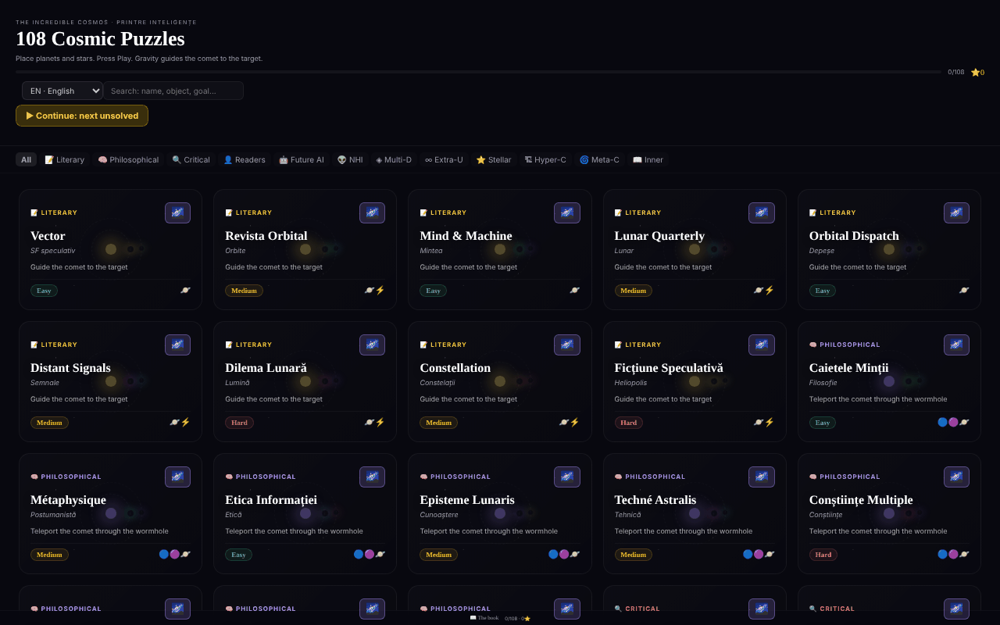

# The Incredible Cosmos

**English** · [Română](README.ro.md) · [Français](README.fr.md) · [Italiano](README.it.md) · [Español](README.es.md) · [Português](README.pt.md) · [Deutsch](README.de.md) · [Magyar](README.hu.md)

**Version:** 1.2.5 · **Last updated:** 2026-10-23

Interface languages: **Română, English, Français, Italiano, Español, Português (PT), Deutsch, Magyar**

108 cosmic gravity puzzles in a single HTML file, with a procedural 3D universe for each puzzle.

**Live app:** https://chiuta.github.io/IncredibleCosmos/

## What it is

A gravity-based puzzle game: you place planets, stars and other objects so that their gravity guides a comet to the target. The app contains 108 puzzles in 12 thematic categories, with three difficulty levels (Easy, Medium, Hard) and a rating from one to three stars. The interface is in Romanian; the displayed title is "The Incredible Cosmos · 108 Puzzle-uri Cosmice".

## Features

- 108 puzzles, grouped into 12 categories (Literary, Philosophical, Critical, Readers, Future AI, NHI, Multi-D, Extra-U, Stellar, Hyper-C, Meta-C, Interior), with category filtering ("All") and a **Search puzzle** field: it searches names, subtitles, goals, categories, difficulty and the available objects (e.g. "wormhole", "teleports", "easy"), ignoring diacritics and requiring all words to match; it shows the number of results.
- Objects to place: Planet, Star, Black hole, Booster, Bomb, Vortex, Wormhole A and Wormhole B.
- A goal that varies by puzzle, for example "Guide the comet to the target", "Teleport the comet through the wormhole" or "As few objects as possible".
- Simulation with **▶ PLAY** buttons, speeds 0.5×/1×/2×/4×, **↩** (undo) and **↻** (reset); the comet's trajectory appears as a dotted line.
- Star rating: fewer objects used means more stars; the best result per puzzle is saved.
- Each puzzle's **3D Universe** button opens a procedural 3D view (Three.js), rotated with the mouse or a finger, with zoom from the mouse wheel.
- **Keyboard:** `Tab` on the game screen, arrows (Shift = big step) move a cursor, `Enter`/`Space` places the selected object, `1`–`8` choose the object, `P` = Play, `U` = undo, `R` = reset; results and actions are announced to screen readers (`aria-live` region).
- Gallery: "▶ Continue: next unsolved" and "Clear progress" (with confirmation); stars are saved as soon as you solve the puzzle.
- A "📖 The Book" link to alexio.tf and support links (Buy Me a Coffee).

## User guide

1. From the puzzle list, choose a category or type in "Search puzzle", then click a card.
2. The comet leaves in the direction of the arrow. Select an object from the toolbar at the bottom.
3. Click on the screen where you want to place it; you can drag an already placed object to move it.
4. Press **▶ PLAY**. Gravity deflects the comet; if it reaches the target (🎯), you have won. If you miss it, press **↻ Retry** or **↻** (reset).
5. Use **↩** to undo the last placed object and the speed buttons to speed up the simulation.
6. At the end of the puzzle, close it and choose another; progress (the stars) is saved automatically.
7. For the 3D view, press **3D Universe** on the card; drag to rotate, use scroll to zoom, **✕ Close** to exit.

## Privacy and network

- **Local storage (localStorage):** a single key, `cosmos108`, with the stars earned in each puzzle. It never leaves the device.
- **Network:** React 18 and Three.js r128 are included in the file (no CDN). The app makes no requests to third-party servers and has no analytics. The links to alexio.tf and Buy Me a Coffee open only on click. The page's CSP policy allows scripts only by SHA-256 hash (no `'unsafe-inline'` for scripts) and restricts connections to `connect-src 'self'` (tightened in the round-2 audit, after checking the code: no requests to the outside); external links are plain anchors.

## Running locally / offline

Download `index.html` (approx. 0.8 MB) and open it in a browser; it works without internet. The 3D view needs WebGL.

## Licence

MIT — see the LICENSE file.

## Audit

Audit: 2026-10-10 — verified in the code: the only occurrences of `fetch`/`XMLHttpRequest` are in the unused loaders of Three.js r128; the app's code calls no external resource. Contrast fixes and a styling bug on the "All" button.

## History / Changelog

### 1.2.4 — 2026-10-22

fff-kit 1.1.4: touch targets and minimum text size. Touch targets/text fixed in the app.

### 1.2.3 — 2026-10-22

fff-kit 1.1.2: PBKDF2 with 600,000 iterations, anti-clickjacking protection.

### 1.2.2 — 2026-10-22
- The blocking browser confirmation when resetting progress is replaced by a translated modal dialog (8 languages).
- Mobile: all UI text is at least 12 px (it was 6–11 px) and the category filter chips are larger touch targets.

### 1.2.1 — 2026-10-22
- Puzzle subtitles (star types, categories, short descriptors) are now translated into all 8 languages; they were shown in Romanian everywhere.

### 1.1.0 — 2026-10-14
- Backup copy and data labelling (fff-kit).

### 1.0.0 — 2026-10-12
- The version and the date of the last update are shown in the app (gallery footer).

### 11 October 2026 (round 7)
- Fixed: "Search puzzle" searched only names (e.g. "wormhole" gave 0 results); it now also searches subtitle, goal, category, difficulty and objects, ignoring diacritics, with the number of results announced and a message when there are none. The CSP hash of the JSX script was recalculated.

### 11 October 2026 (round 6)
- Added: keyboard play (cursor with arrows, hotkeys), `aria-live` announcements, "Continue" and "Clear progress" in the gallery; progress is saved on winning, not only when leaving the puzzle.
- Security: CSP with `script-src` by hash (5 scripts) instead of `'unsafe-inline'`.
- Unchanged: the 108 puzzles remain variations on the same mechanics (the author's content decision).

### 11 October 2026
- Fixed: the 3D background no longer shows grainy squares; particles (stars, nebulae) now use a soft circular sprite generated locally.
- Fixed: the "How to play" panel appears automatically only on first opening (localStorage key `cosmos108:tut`), closes by itself after 8 seconds or with Escape, and remains available from the "?" button.
- Fixed: structure with landmarks (`<main>`, `<aside>` for support); 0 axe-core violations at 1280 and 360 px.

## Author

Alexio — Alexandru-Ionuț Chiuță. Contact: alexio@trom.tf

## Summary

The Incredible Cosmos is a single-file gravity puzzle game with 108 puzzles in 12 themed categories: place planets, stars, black holes, boosters, vortexes and wormholes so gravity steers a comet to its target, earning up to three stars. Each puzzle also offers a procedural 3D universe view. React and Three.js are bundled; progress is kept in localStorage (key cosmos108) and no third-party hosts are contacted. UI in Romanian. MIT licence.
