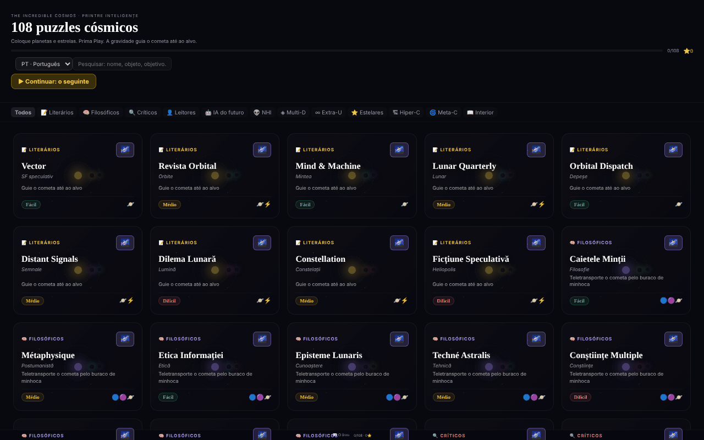

# The Incredible Cosmos

[English](README.md) · [Română](README.ro.md) · [Français](README.fr.md) · [Italiano](README.it.md) · [Español](README.es.md) · **Português** · [Deutsch](README.de.md) · [Magyar](README.hu.md)

**Versão:** 1.2.7 · **Última atualização:** 2026-10-23

Idiomas da interface: **Română, English, Français, Italiano, Español, Português (PT), Deutsch, Magyar**

108 quebra-cabeças cósmicos de gravidade num único ficheiro HTML, com um universo 3D procedimental para cada quebra-cabeças.

**Aplicação online:** https://chiuta.github.io/IncredibleCosmos/

## O que é

Um jogo de quebra-cabeças baseado na gravidade: colocam-se planetas, estrelas e outros objetos de modo a que a sua gravidade guie um cometa até ao alvo. A aplicação contém 108 quebra-cabeças em 12 categorias temáticas, com três níveis de dificuldade (Fácil, Médio, Difícil) e uma avaliação de uma a três estrelas. A interface está em romeno; o título apresentado é «The Incredible Cosmos · 108 Puzzle-uri Cosmice».

## Funcionalidades

- 108 quebra-cabeças, agrupados em 12 categorias (Literárias, Filosóficas, Críticas, Leitores, IA do futuro, NHI, Multi-D, Extra-U, Estelares, Hiper-C, Meta-C, Interior), com filtragem por categoria («Todas») e um campo **Pesquisar quebra-cabeças**: pesquisa em nomes, subtítulos, objetivos, categorias, dificuldade e objetos disponíveis (p. ex. «wormhole», «teletransporta», «fácil»), sem ter em conta os sinais diacríticos e exigindo que todas as palavras correspondam; mostra o número de resultados.
- Objetos a colocar: Planeta, Estrela, Buraco negro, Booster, Bomba, Vórtice, Wormhole A e Wormhole B.
- Um objetivo que varia consoante o quebra-cabeças, por exemplo «Guia o cometa até ao alvo», «Teletransporta o cometa através do wormhole» ou «O menor número possível de objetos».
- Simulação com os botões **▶ PLAY**, velocidades 0,5×/1×/2×/4×, **↩** (anular) e **↻** (repor); a trajetória do cometa aparece como uma linha ponteada.
- Estrelas de avaliação: menos objetos usados significa mais estrelas; o melhor resultado por quebra-cabeças é guardado.
- O botão **Universo 3D** de cada quebra-cabeças abre uma vista 3D procedimental (Three.js), rodada com o rato ou com o dedo, com zoom pela roda do rato.
- **Teclado:** `Tab` no ecrã de jogo, as setas (Shift = passo grande) movem um cursor, `Enter`/`Espaço` coloca o objeto selecionado, `1`–`8` escolhem o objeto, `P` = Play, `U` = anular, `R` = repor; os resultados e as ações são anunciados aos leitores de ecrã (região `aria-live`).
- Galeria: «▶ Continuar: o próximo por resolver» e «Apagar o progresso» (com confirmação); as estrelas são guardadas assim que resolve o quebra-cabeças.
- Uma ligação «📖 O livro» para alexio.tf e ligações de apoio (Buy Me a Coffee).

## Manual de utilização

1. Na lista de quebra-cabeças, escolha uma categoria ou escreva em «Pesquisar quebra-cabeças» e depois clique num cartão.
2. O cometa parte na direção da seta. Selecione um objeto na barra de ferramentas inferior.
3. Clique no ecrã onde pretende colocá-lo; pode arrastar um objeto já colocado para o mover.
4. Prima **▶ PLAY**. A gravidade desvia o cometa; se chegar ao alvo (🎯), ganhou. Se o falhar, prima **↻ Tentar de novo** ou **↻** (repor).
5. Use **↩** para anular o último objeto colocado e os botões de velocidade para acelerar a simulação.
6. No final do quebra-cabeças, feche-o e escolha outro; o progresso (as estrelas) é guardado automaticamente.
7. Para a vista 3D, prima **Universo 3D** no cartão; arraste para rodar, use o scroll para fazer zoom, **✕ Fechar** para sair.

## Privacidade e rede

- **Armazenamento local (localStorage):** uma única chave, `incrediblecosmos.progress`, com as estrelas ganhas em cada quebra-cabeças. Não sai do dispositivo.
- **Rede:** o React 18 e o Three.js r128 estão incluídos no ficheiro (sem CDN). A aplicação não faz pedidos a servidores de terceiros e não tem análise estatística. As ligações para alexio.tf e Buy Me a Coffee só se abrem ao clicar. A política CSP da página permite scripts apenas por hash SHA-256 (sem `'unsafe-inline'` para scripts) e restringe as ligações a `connect-src 'self'` (apertada na auditoria da ronda 2, após verificação do código: nenhum pedido para o exterior); as ligações externas são simples âncoras.

## Execução local / offline

Descarregue `index.html` (cerca de 0,8 MB) e abra-o num navegador; funciona sem internet. Para a vista 3D é necessário WebGL.

## Licença

MIT — consulte o ficheiro LICENSE.

## Auditoria

Auditoria: 2026-10-10 — verificado no código: as únicas ocorrências de `fetch`/`XMLHttpRequest` estão nos carregadores (loaders) não utilizados do Three.js r128; o código da aplicação não chama nenhum recurso externo. Correções de contraste e um erro de estilo no botão «Todas».

## Histórico / Registo de alterações

### 1.2.7 — 2026-10-23

- Correção: uma entrada de progresso danificada (`null`, número de estrelas negativo ou enorme em `incrediblecosmos.progress`) fazia falhar todo o ecrã no arranque; o progresso é agora validado (0–3 estrelas por puzzle). O `app.json` lista agora a chave `incrediblecosmos.progress`. Novo teste de regressão.

### 1.2.6 — 2026-10-23

- Armazenamento: as chaves passam a ter o prefixo da aplicação (`incrediblecosmos.progress`, `incrediblecosmos.lang`, `incrediblecosmos.tut`); os dados existentes são migrados automaticamente no arranque a partir das chaves antigas (`cosmos108`, `cosmos108:lang`, `cosmos108:tut`) e as cópias `.fff.json` antigas continuam a ser importadas (fff-kit 1.2.0).
- Diálogos: as caixas nativas `alert`/`confirm`/`prompt` foram substituídas por diálogos `FFF.dialog` acessíveis e traduzidos (teclado, armadilha de foco, Esc), com o mesmo comportamento (fff-kit 1.2.0).

### 1.2.4 — 2026-10-22

fff-kit 1.1.4: áreas de toque e texto mínimo. Áreas de toque/texto corrigidos na aplicação.

### 1.2.3 — 2026-10-22

fff-kit 1.1.2: PBKDF2 com 600.000 iterações, proteção anti-clickjacking.

### 1.2.2 — 2026-10-22
- A confirmação bloqueante do navegador ao repor o progresso é substituída por um diálogo modal traduzido (8 idiomas).
- Móvel: todo o texto da interface tem pelo menos 12 px (antes 6–11 px) e os botões de filtro por categoria têm áreas táteis maiores.

### 1.2.1 — 2026-10-22
- Os subtítulos dos puzzles (tipos de estrelas, categorias, descrições curtas) foram traduzidos para os 8 idiomas; antes apareciam sempre em romeno.

### 1.1.0 — 2026-10-14
- Cópia de segurança e etiquetagem de dados (fff-kit).

### 1.0.0 — 2026-10-12
- A versão e a data da última atualização são apresentadas na aplicação (rodapé da galeria).

### 11 de outubro de 2026 (ronda 7)
- Corrigido: «Pesquisar quebra-cabeças» pesquisava apenas nos nomes (p. ex. «wormhole» dava 0 resultados); agora pesquisa também no subtítulo, no objetivo, na categoria, na dificuldade e nos objetos, sem ter em conta os sinais diacríticos, com o número de resultados anunciado e uma mensagem quando não existe nenhum. O hash CSP do script JSX foi recalculado.

### 11 de outubro de 2026 (ronda 6)
- Adicionado: jogo com teclado (cursor com setas, teclas de atalho), anúncios `aria-live`, «Continuar» e «Apagar o progresso» na galeria; o progresso é guardado ao ganhar, não apenas ao sair do quebra-cabeças.
- Segurança: CSP com `script-src` por hash (5 scripts) em vez de `'unsafe-inline'`.
- Inalterado: os 108 quebra-cabeças continuam a ser variações sobre as mesmas mecânicas (decisão de conteúdo do autor).

### 11 de outubro de 2026
- Corrigido: o fundo 3D já não mostra quadrados granulados; as partículas (estrelas, nebulosas) usam agora um sprite circular suave gerado localmente.
- Corrigido: o painel «Como se joga» aparece automaticamente apenas na primeira abertura (chave localStorage `cosmos108:tut`), fecha-se sozinho após 8 segundos ou com Escape e continua disponível no botão «?».
- Corrigido: estrutura com pontos de referência (`<main>`, `<aside>` para o apoio); 0 violações do axe-core a 1280 e 360 px.

## Autor

Alexio — Alexandru-Ionuț Chiuță. Contacto: alexio@trom.tf

## Resumo

The Incredible Cosmos é um jogo de quebra-cabeças de gravidade num único ficheiro, com 108 quebra-cabeças em 12 categorias temáticas: coloque planetas, estrelas, buracos negros, boosters, vórtices e wormholes para que a gravidade encaminhe um cometa até ao seu alvo, ganhando até três estrelas. Cada quebra-cabeças oferece ainda uma vista procedimental do universo em 3D. O React e o Three.js estão incluídos; o progresso é guardado em localStorage (chave cosmos108) e não é contactado nenhum anfitrião de terceiros. Interface em romeno. Licença MIT.
