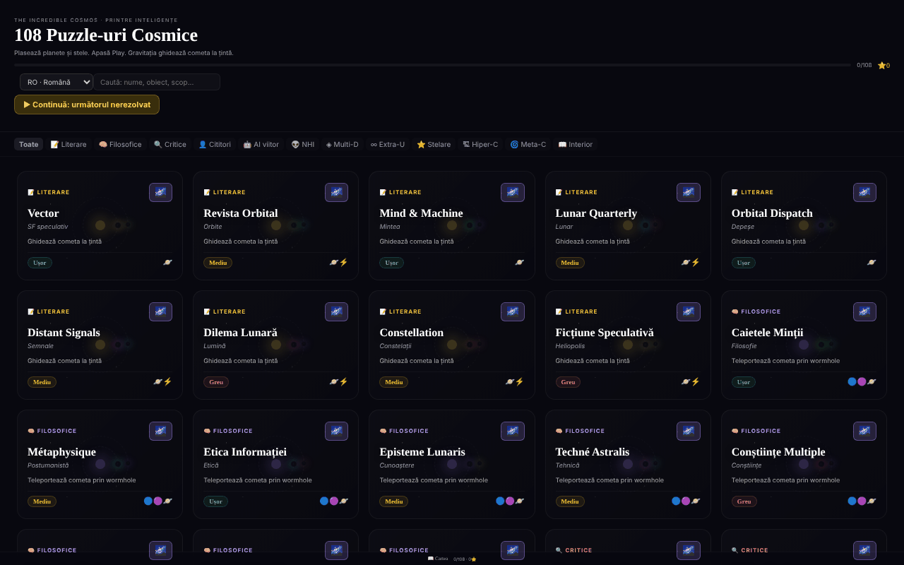

# The Incredible Cosmos

[English](README.md) · **Română** · [Français](README.fr.md) · [Italiano](README.it.md) · [Español](README.es.md) · [Português](README.pt.md) · [Deutsch](README.de.md) · [Magyar](README.hu.md)

**Versiune:** 1.2.6 · **Ultima actualizare:** 2026-10-23

Limbile interfeței: **Română, English, Français, Italiano, Español, Português (PT), Deutsch, Magyar**

108 puzzle-uri cosmice de gravitație, într-un singur fișier HTML, cu un univers 3D procedural pentru fiecare puzzle.

**Live:** https://chiuta.github.io/IncredibleCosmos/

## Ce este

Un joc de puzzle bazat pe gravitație: plasezi planete, stele și alte obiecte astfel încât gravitația lor să ghideze o cometă către țintă. Aplicația conține 108 puzzle-uri în 12 categorii tematice, cu trei niveluri de dificultate (Ușor, Mediu, Greu) și evaluare de la una la trei stele. Interfața este în limba română; titlul afișat este „The Incredible Cosmos · 108 Puzzle-uri Cosmice”.

## Funcții

- 108 puzzle-uri, grupate în 12 categorii (Literare, Filosofice, Critice, Cititori, AI viitor, NHI, Multi-D, Extra-U, Stelare, Hiper-C, Meta-C, Interior), cu filtrare pe categorii („Toate”) și câmp **Caută puzzle**: caută în nume, subtitlu, scop, categorie, dificultate și obiectele disponibile (de ex. „wormhole”, „teleportează”, „ușor”), fără diacritice și cu toate cuvintele potrivite; afișează numărul de rezultate.
- Obiecte de plasat: Planetă, Stea, Gaură neagră, Booster, Bombă, Vortex, Wormhole A și Wormhole B.
- Scop variabil pe puzzle, de exemplu „Ghidează cometa la țintă”, „Teleportează cometa prin wormhole” sau „Cât mai puține obiecte”.
- Simulare cu butoane **▶ PLAY**, viteze 0,5×/1×/2×/4×, **↩** (anulare) și **↻** (reset); traiectoria cometei apare ca linie punctată.
- Stele de evaluare: mai puține obiecte folosite înseamnă mai multe stele; cel mai bun rezultat per puzzle este salvat.
- Butonul **Univers 3D** al fiecărui puzzle deschide o vedere 3D procedurală (Three.js), rotită cu mouse-ul sau degetul, cu zoom din rotița mouse-ului.
- **Tastatură:** `Tab` pe ecranul de joc, săgeți (Shift = pas mare) mută un cursor, `Enter`/`Spațiu` plasează obiectul selectat, `1`–`8` aleg obiectul, `P` = Play, `U` = anulează, `R` = reset; rezultatele și acțiunile sunt anunțate pentru cititoarele de ecran (regiune `aria-live`).
- Galeria: „▶ Continuă: următorul nerezolvat” și „Șterge progresul” (cu confirmare); stelele se salvează imediat ce rezolvi puzzle-ul.
- Link „📖 Cartea” către alexio.tf și linkuri de sprijin (Buy Me a Coffee).

## Manual de utilizare

1. Din lista de puzzle-uri, alege o categorie sau scrie în „Caută puzzle”, apoi apasă pe un card.
2. Cometa pleacă în direcția săgeții. Selectează un obiect din bara de unelte de jos.
3. Apasă pe ecran unde vrei să-l plasezi; poți trage un obiect deja plasat pentru a-l muta.
4. Apasă **▶ PLAY**. Gravitația deviază cometa; dacă ajunge la țintă (🎯), ai câștigat. Dacă o pierzi, apasă **↻ Reîncearcă** sau **↻** (reset).
5. Folosește **↩** pentru a anula ultimul obiect plasat și butoanele de viteză pentru a accelera simularea.
6. La finalul puzzle-ului, închide și alege altul; progresul (stelele) se salvează automat.
7. Pentru vederea 3D, apasă **Univers 3D** pe card; trage pentru a roti, folosește scroll pentru zoom, **✕ Închide** pentru ieșire.

## Confidențialitate și rețea

- **Stocare locală (localStorage):** o singură cheie, `incrediblecosmos.progress`, cu stelele câștigate la fiecare puzzle. Nu părăsește dispozitivul.
- **Rețea:** React 18 și Three.js r128 sunt incluse în fișier (fără CDN). Aplicația nu face cereri către servere terțe și nu are analytics. Linkurile către alexio.tf, Buy Me a Coffee se deschid doar la clic. Politica CSP a paginii permite scripturile doar pe bază de hash SHA-256 (fără `'unsafe-inline'` pentru script) și restricționează conexiunile la `connect-src 'self'` (strâns în auditul din runda 2, după verificarea codului: nicio cerere către exterior); linkurile externe sunt simple ancore.

## Rulare locală / offline

Descarcă `index.html` (aprox. 0,8 MB) și deschide-l în browser; funcționează fără internet. Pentru vederea 3D este nevoie de WebGL.

## Licență

MIT — vezi fișierul LICENSE.

## Audit

Audit: 2026-10-10 — verificat în cod: singurele apariții de `fetch`/`XMLHttpRequest` sunt în încărcătoarele (loaders) nefolosite din Three.js r128; codul aplicației nu apelează nicio resursă externă. Corecturi de contrast și un bug de stil la butonul „Toate”.

## Istoric / Changelog

### 1.2.6 — 2026-10-23

- Stocare: cheile poartă acum prefixul aplicației (`incrediblecosmos.progress`, `incrediblecosmos.lang`, `incrediblecosmos.tut`); datele existente se mută automat la pornire din cheile vechi (`cosmos108`, `cosmos108:lang`, `cosmos108:tut`), iar copiile `.fff.json` mai vechi se importă în continuare (fff-kit 1.2.0).
- Dialoguri: casetele native `alert`/`confirm`/`prompt` au fost înlocuite cu dialoguri `FFF.dialog` accesibile și traduse (tastatură, capcană de focus, Escape), cu același comportament (fff-kit 1.2.0).

### 1.2.4 — 2026-10-22

fff-kit 1.1.4: ținte tactile și text minim. Ținte tactile/text corectate în aplicație.

### 1.2.3 — 2026-10-22

fff-kit 1.1.2: PBKDF2 600 000 iterații, protecție anti-clickjacking.

### 1.2.2 — 2026-10-22
- Confirmarea blocantă a browserului la resetarea progresului este înlocuită cu un dialog modal tradus (8 limbi).
- Mobil: tot textul interfeței are cel puțin 12 px (era 6–11 px), iar butoanele de filtrare pe categorii au ținte tactile mai mari.

### 1.2.1 — 2026-10-22
- Subtitlurile puzzle-urilor (tipuri de stele, categorii, descrieri scurte) sunt traduse în toate cele 8 limbi; înainte apăreau în română peste tot.

### 1.1.0 — 2026-10-14
- Copie de rezervă și etichetare date (fff-kit).

### 1.0.0 — 2026-10-12
- Versiunea și data ultimei actualizări sunt afișate în aplicație (subsolul galeriei).

### 11 octombrie 2026 (runda 7)
- Reparat: „Caută puzzle” căuta doar în nume (de ex. „wormhole” dădea 0 rezultate); acum caută și în subtitlu, scop, categorie, dificultate și obiecte, fără diacritice, cu număr de rezultate anunțat și mesaj când nu există niciunul. Hash-ul CSP al scriptului JSX a fost recalculat.

### 11 octombrie 2026 (runda 6)
- Adăugat: joc de la tastatură (cursor cu săgeți, taste rapide), anunțuri `aria-live`, „Continuă” și „Șterge progresul” în galerie; progresul se salvează la câștig, nu doar la părăsirea puzzle-ului.
- Securitate: CSP cu `script-src` pe hash (5 scripturi) în locul `'unsafe-inline'`.
- Neschimbat: cele 108 puzzle-uri rămân variații pe aceleași mecanici (decizie de conținut a autorului).

### 11 octombrie 2026
- Reparat: fundalul 3D nu mai afișează pătrate granulate; particulele (stele, nebuloase) folosesc acum un sprite circular moale generat local.
- Reparat: panoul „Cum se joacă” apare automat doar la prima deschidere (cheie localStorage `cosmos108:tut`), se închide singur după 8 secunde sau cu Escape și rămâne disponibil din butonul „?”.
- Reparat: structură cu repere (`<main>`, `<aside>` pentru sprijin); 0 violări axe-core la 1280 și 360 px.

## Autor

Alexio — Alexandru-Ionuț Chiuță. Contact: alexio@trom.tf

## Rezumat

The Incredible Cosmos este un joc-puzzle gravitațional într-un singur fișier, cu 108 puzzle-uri în 12 categorii tematice: plasezi planete, stele, găuri negre, amplificatoare, vârtejuri și găuri de vierme astfel încât gravitația să ghideze o cometă spre țintă, câștigând până la trei stele. Fiecare puzzle oferă și o vedere procedurală 3D a universului. React și Three.js sunt incluse în fișier; progresul se păstrează în localStorage (cheia cosmos108) și nu se contactează gazde terțe. Interfață în română. Licență MIT.
